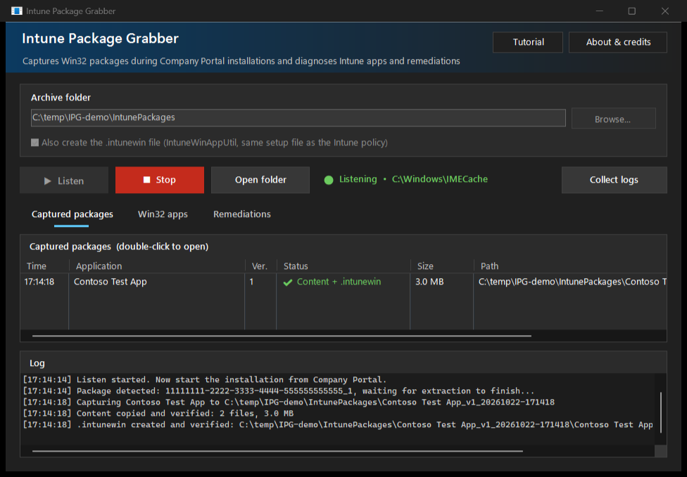
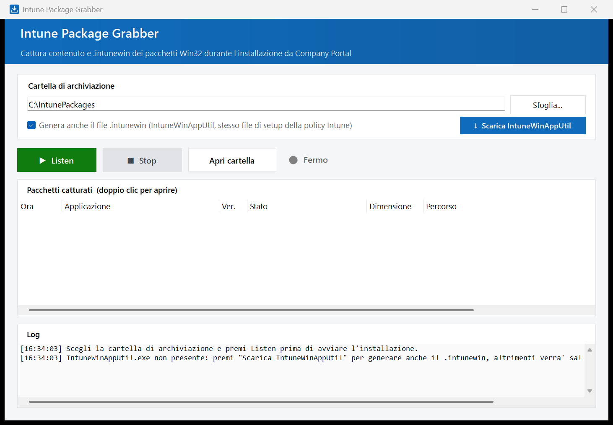

# IntunePackageGrabber

Windows tool (WinForms, single exe) that archives the Win32 packages Intune Management Extension (IME) downloads when an app is installed from Company Portal.

IME extracts the content to `C:\Windows\IMECache\<AppId>_<version>` and deletes it when the installation ends. The tool watches the cache, waits until the extraction is complete and saves each package to the chosen folder:

- `Content\` - verified copy (file count and bytes) of the extracted content
- `<App name>.intunewin` - rebuilt with IntuneWinAppUtil, using the setup file from the IME policy
- `app-info.txt` and `policy.json` - name, version, install/uninstall commands, requirements, detection rules (decoded: MSI, file, registry, script) and return codes read from `AppWorkload.log`
- `detection.ps1` - the detection script, when the app uses one

If the `.intunewin` cannot be created, the content is saved anyway.



The saved `.intunewin` is rebuilt from the content: it installs the same files, but it is not byte-identical to the original one uploaded to Intune (it is encrypted with new keys).

## Download

The exe is on the [Releases](../../releases/latest) page.

## Usage

1. Run `IntunePackageGrabber.exe` (requires administrator rights).
   If you need the `.intunewin` and IntuneWinAppUtil.exe is not present, press **Download IntuneWinAppUtil**: the tool downloads it from the [Microsoft repository](https://github.com/microsoft/Microsoft-Win32-Content-Prep-Tool), checks its Microsoft Authenticode signature and saves it to `%APPDATA%\IntunePackageGrabber\`.

   
2. Choose the archive folder.
3. Press **Listen**, then start the installation from Company Portal.
4. Press **Stop** when done.

Command line options: `--dest <folder>`, `--listen`, `--cache <folder>`, `--log <file>`, `--imelogs <folder>`, `--exit-after <seconds>`.

Settings and log: `%APPDATA%\IntunePackageGrabber\`.

## Requirements

- Intune-managed Windows 10/11, .NET Framework 4.8
- [IntuneWinAppUtil.exe](https://github.com/microsoft/Microsoft-Win32-Content-Prep-Tool), only to create the `.intunewin`. It is looked up in this order: next to the exe, in `%APPDATA%\IntunePackageGrabber\` (download button), embedded in the exe.

## Build

```powershell
# Same as the release: IntuneWinAppUtil not embedded
powershell -ExecutionPolicy Bypass -File src\build.ps1 -NoEmbed -Output .\IntunePackageGrabber.exe

# With IntuneWinAppUtil embedded (internal use)
powershell -ExecutionPolicy Bypass -File src\build.ps1 -IntuneWinAppUtil <path>\IntuneWinAppUtil.exe -Output .\IntunePackageGrabber.exe
```

Uses the C# compiler of .NET Framework included in Windows, no SDK required.

## Tests

```powershell
powershell -ExecutionPolicy Bypass -File src\test.ps1 -Work C:\temp\IPG-tests -Exe .\IntunePackageGrabber.exe
```

Simulates IME on a fake cache and `AppWorkload.log`: progressive extraction with files still open for writing, parallel packages, folders removed during the copy, retries, paths over 260 characters, unknown setup file, detection rule decoding, Listen/Stop buttons.
